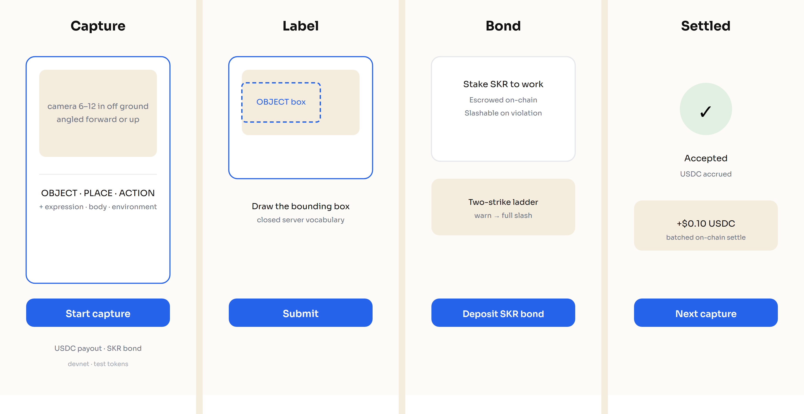

# Capture

**Decentralized RLHF — humans judge model outputs, consensus decides who gets paid.**

Capture is a mobile RLHF preference-judging network for the CLOCK IN hackathon
(Solana Mobile × RadiantsDAO), built for **Solana Seeker Mobile**. A judge sees
two vision-model outputs and picks the better one (A/B preference) or rates a
single output 1–5. Aggregated preferences become an RLHF preference dataset,
with trust priced into every judgment through a slashable **test-SKR** stake.



## The judgment product

Capture pivoted from "people shoot ground-level footage" to "people judge a
vision model's outputs for RLHF." The incentive is **consensus-gated pay in
test $SKR**: every pair goes to K=3 judges; the majority pick wins, aligned
judges are paid (`base_skr × level multiplier`), dissenters earn nothing, and
**"can't tell" is a first-class answer** that re-routes the pair instead of
forcing a guess. New judges pass a 10-pair calibration gate before they can
stake, and a judge-accuracy ladder (agreement-rate driven) raises their rate
multiplier. Systematic disagreement below a floor runs the two-strike bond
warn/slash ladder on-chain, and each resolved batch commits a Merkle root
on-chain as provenance.

Honest notes (state, do not hide):

- **Test tokens.** $SKR here is **devnet/test $SKR** for the hackathon. It is not
  real value. The UI and `/health` both say so.
- **Majority-preference bias.** RLHF on majority preference flattens minority and
  edge preferences. This is fine for a first pass, but the dataset does **not**
  represent all humans. Do not claim it does.
- K, thresholds, and rates are starting hypotheses — tune against real agreement
  data, not once.

The original capture-collection flow (ground-level media) is **dormant** — the
code remains but is not part of the judging path.

## How it works

1. **Prove human (liveness gate).** Before a first upload, the backend issues a
   fresh, single-use motion challenge (blink, turn left, turn right, smile).
   The check runs on-device; no biometric material leaves the phone. This is a
   liveness gate, not bank-grade anti-spoofing.
2. **Capture.** The worker records ground-level egocentric capture — the camera
   held 6–12 inches off the ground, angled forward or up — as a photo (an
   object or place) or a short video (an action).
3. **Moderate.** Moderation runs first, fail-closed: Sightengine nudity-2.0,
   face-age, and genai detection. An outage blocks with 503 — it never strikes
   a worker's bond, and never passes silently.
4. **Label.** The worker applies six label dimensions against a server-owned
   closed vocabulary.
5. **Judge.** A vision-language-model quality judge accepts or rejects each
   submission (gpt-6-astra via the Codex CLI, behind `backend/seeker/judge.py`).
6. **Settle.** An accepted submission accrues a test-USDC payout (base rate ×
   level multiplier × label premium) off-chain and advances the worker's level;
   a media-policy violation triggers the two-strike bond ladder — first strike
   `warn` (bond intact), second strike `slash` (full bond drained on-chain to a
   penalty vault). Payouts settle on-chain in a batched transfer
   (`POST /bond/settle`).

## Label dimensions

Six dimensions, drawn from a server-owned closed vocabulary (`GET /taxonomy`):

| Dimension   | Required | What it captures |
|-------------|----------|------------------|
| OBJECT      | yes      | bounding box(es) around the object |
| PLACE       | yes      | a single scene class |
| ACTION      | yes      | a video trim plus one tag |
| POSTURE     | yes      | the subject's pose |
| EXPRESSION  | no       | facial expression |
| ENVIRONMENT | no       | indoor/outdoor, time, weather, surface, light |

Four optional metadata tags round out a capture: **surface type**, **lighting**,
**weather**, and **ego-motion** (a static action shot is rejected outright — an
image would do).

## Progression

Five levels, gated by both a cumulative accepted-count and a rolling acceptance
rate over the last 50 judged submissions:

```
Scout → Regular → Veteran → Expert → Pathfinder
```

Every contributor is at least a Scout. The test-SKR bond requirement scales down
with level and is waived at Pathfinder.

## Tokens & settlement

- **test-SKR** — one token, three jobs: **stake** (deposit to unlock paid
  judging), **reward** (consensus-aligned judgments earn SKR), **slash** (lose
  stake for systematic disagreement). A devnet fixture mint.

Settlement is **real on-chain transfer**: the SKR bond escrows on-chain at
deposit, aligned judges are paid test-SKR on agreement, and a systematic
disagreement warns then slashes the bond to a penalty vault. Each resolved batch
commits a Merkle root on-chain as provenance.

## The judge

The quality judge is a vision-language model behind a clean abstraction
(`backend/seeker/judge.py`), driven by `gpt-6-astra` via the Codex CLI. It is
bounded by a per-wallet daily cap and fails closed (503) when it cannot be
reached — an accepted upload must never settle silently.

## Status

October 12 2026:

- Deployed to **Solana devnet**; backend live at `https://capture.magnumopus.ai`.
- **133 backend tests** and **105 Android tests** pass.
- The SKR bond is a real on-chain staking contract with full slash, live on
  devnet.
- Everything here runs on **devnet test tokens**.

Not done / honest caveats:

- Liveness is an on-device motion challenge, not bank-grade anti-spoofing
  (device attestation is a roadmap item). A degenerate (all-zero) result digest
  is rejected, but the server cannot cryptographically verify the motion itself.
- Moderation (Sightengine nudity + face-age + genai) is fail-closed in code,
  not validated as a compliance claim.
- The ground-level angle is asserted by the human and checked by the judge, not
  yet enforced by measured device pose (capture-verification is a roadmap item).
- Sybil resistance is partial: the bond raises the cost of fake accounts but
  does not eliminate them.

## Repository layout

```
.
├── android/            Solana Seeker Mobile app (Kotlin / Gradle)
│   └── app/            capture, label, judge UI; unit tests under src/test
├── backend/            FastAPI service
│   ├── seeker/         Capture v2 API, taxonomy, judge, leveling, chain, DB
│   ├── migrations/     database migrations
│   └── tests/          backend test suite
├── programs/           Anchor workspaces
│   └── seeker-bounty/  on-chain settlement + SKR bond program
├── scripts/            devnet bootstrap and demo helpers
├── docs/               deck + screenshot assets
└── .github/            CI workflows
```

## Quick start

Four commands from a fresh clone to a running backend (devnet, throwaway
dev-only keys — never the real operator/media/verifier secrets):

```bash
git clone https://github.com/chunli0x/capture.git && cd capture

# 1. PostgreSQL (Docker) — loopback-only by default
docker compose up -d

# 2. venv + dependencies + dev-only keys + DB schema; writes backend/.env
./scripts/dev_bootstrap.sh

# 3. run the API (loads the generated backend/.env)
cd backend && .venv/bin/uvicorn seeker.api:production_app --factory --env-file .env

# 4. verify
curl -s http://localhost:8000/health
```

Expected output from `/health`:

```json
{"service":"seeker","network":"devnet","production_ready":false}
```

Notes:

- The backend listens on **port 8000**. The Android Capture v2 client defaults
  to `SEEKER_API_BASE=http://10.0.2.2:8001` (see `android/app/build.gradle.kts`),
  and the emulator reaches your machine via `10.0.2.2`, not `localhost`. To
  connect the app, either run the backend with `--port 8001`, or rebuild the
  app with `-PseekerApiBase=http://10.0.2.2:8000`.
- `dev_bootstrap.sh` generates a throwaway operator key, a throwaway media
  encryption key, and a freshly generated dev-only verifier keypair
  (`backend/verifier.dev.json`) and writes them to `backend/.env`. These are
  intentionally **not** the real verifier — the real key authorizes every
  attestation and is never committed. Anything that needs the real verifier
  on-chain will fail until you point `SEEKER_VERIFIER_KEY_FILE` at your own
  keypair.
- No Docker? Use SQLite instead — uncomment the
  `SEEKER_DATABASE_URL=sqlite:///./seeker.db` and `SEEKER_LOCAL_SQLITE=true`
  lines in `backend/.env` (or run
  `SEEKER_LOCAL_SQLITE=true SEEKER_DATABASE_URL=sqlite:///./seeker.db ./scripts/dev_bootstrap.sh`).
- The dependency set is tested on Python 3.11. If `python3` is a newer minor,
  pass `PYTHON=python3.11 ./scripts/dev_bootstrap.sh`.
- Media moderation (Sightengine) is unconfigured by default, so uploads block
  with 503 — that is expected and safe. The API still starts and `/health` still
  responds.

## Build & run

Backend:

```bash
cd backend
.venv/bin/pip install -r requirements-seeker.txt
.venv/bin/python -m seeker.migrate
.venv/bin/uvicorn seeker.api:production_app --factory --env-file .env
```

(Or just run `./scripts/dev_bootstrap.sh`, which does all of the above and
writes `backend/.env`.)

Android (unit tests):

```bash
cd android && ./gradlew testDebugUnitTest
```

Gradle locates the SDK via `ANDROID_HOME` (or `android/local.properties`, which
is gitignored — never commit a machine path). To build an APK for the emulator:

```bash
cd android && ./gradlew assembleDebug
```

Remember the port note above: the app's Capture v2 client points at
`10.0.2.2:8001` by default while the backend serves on `8000`.
