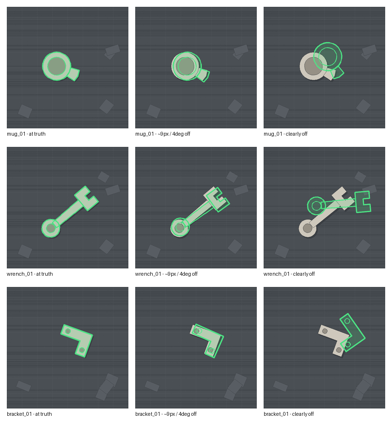
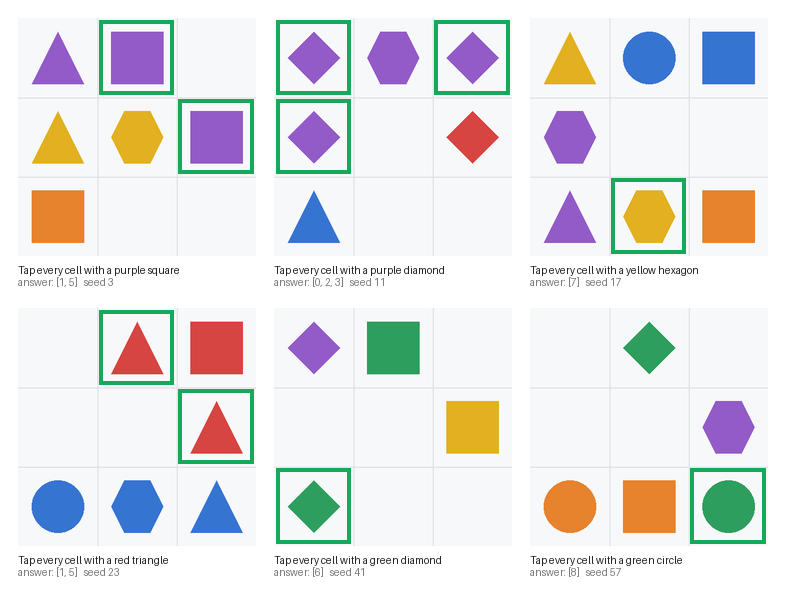
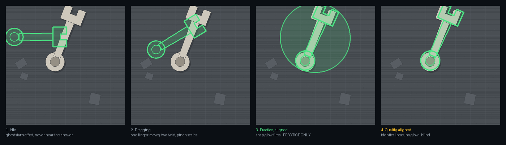

# Union

A staked proof-of-human-work network, built on a mobile labeling engine.
Contributors prove they are human on their phone, do a task a bot finds hard,
and an attestation is minted with a HUMAN bond behind it. The credential is
the product; the labeling engine underneath it is what produces the work.

What that attestation is, stated the same way everywhere in this repo: a
verifier-vouched, bond-secured record that a human completed a task. On-chain
you get identity, bond, timestamp and a verifier signature. The liveness check
and the grading happen off-chain, inside the verifier. It is not cryptographic
proof of humanness, and slashing is implemented but not yet enforced.

Built for [CLOCK IN](https://docs.solanamobile.com/hackathon/) — Solana Mobile ×
RadiantsDAO, September 8 – October 8 2026.

> **Status: week 3 of 4.** The labeling engine (ghost overlay and clip
> judgment), the verifier-signed attestation layer, both on-chain programs, and
> the demand side (agents buying a human judgment over x402, with Jev routing
> escalation) are built. A plain `pytest -q` reports **504 passed, 13 skipped**
> (the skips are on-chain tests behind `TAPFARM_E2E=1`), alongside **42** Rust
> logic tests across both programs. The on-device MWA handshake is the open
> item. See [docs/SPIKE.md](docs/SPIKE.md) for the full ledger of what is
> proven and what is not.

## The demand side — agents pay for a human judgment

The other half of the loop, and the headline of week 3: an agent that hits a
step it cannot resolve calls `/v1/judge`, **Jev** (TypeSafe AI's "System One"
classifier) routes whether a human is even needed, and — if one is — the agent
pays over **x402 V2** and the request queues for a quorum of humans to judge.

> **Why Jev matters.** Not every unresolved step is worth a human. Jev answers
> four routing questions as *calibrated probabilities* (`needs_human`,
> `is_ambiguous`, `is_risky`, `agent_confidence_ok`) in milliseconds; if none
> crosses its threshold the agent is told `no_human_needed` and **charged
> nothing**. Jev only decides *when* to escalate — it can never produce the
> judgment itself, which the type system enforces (the routing result has four
> probability fields and no verdict field). See [docs/DEMAND-SIDE.md](docs/DEMAND-SIDE.md)
> for the integration, and [docs/jev-onchain-trust-layer.md](docs/jev-onchain-trust-layer.md)
> for the on-chain trust-layer design (judgments as signed opinions, not facts).

## Tokens

Four mints, four jobs. The split is not cosmetic — it decides what we are allowed
to destroy.

**TAP** is ours: what contributors earn, and the **slashable** quality bond.
`slash` is implemented on the stake program and tested on-chain, but **nothing
in the backend calls it yet** — a bond cannot currently be burned by bad work,
because no running code path triggers it. Wiring that up is listed in
[PLATFORM.md](docs/PLATFORM.md) under work that is decided and not yet built.

**SKR** is Solana Mobile's. We never mint it and we never burn it. It is a
**non-slashable** access stake: locking real SKR signals platform commitment and
unlocks referral earnings. `slash` has no asset parameter at all, so SKR being
untouchable is a property of the program's interface rather than of calling it
carefully — and `test_slashing_never_touches_the_skr_stake` tries a maximal
slash to prove it.

Because SKR does not exist on devnet, the bootstrap script creates a plain local
mint to occupy the access-stake slot in tests. It is a test fixture, is never
shown to a user as SKR, and on mainnet that slot holds the canonical SKR mint —
the program cannot tell the difference, which is the point.

**HUMAN** is the attestation bond: the slashable stake behind an attestation.
It is a separate mint from the access gate for the same reason the stake program
takes two mints — so that "SKR is never slashed" is a fact about the system
rather than a promise about our future conduct. Slashing is implemented but not
yet enforced.

**USDC** is payroll. Contributors are paid a stablecoin, never the token. On
devnet the bootstrap script mints a stand-in because devnet has no USDC we
control; on mainnet this slot holds the canonical USDC mint and the treasury
holds a balance rather than mint authority. The stand-in is never shown as if it
were real USDC.

### The numbers

| | Default | Why |
|---|---|---|
| Reward per task | 0.01 TAP | 100 tasks to a whole token — visible movement, not dust |
| Minimum TAP bond | 0.1 TAP (~10 tasks) | Demo-tuned. In production a bond must exceed what a burst of bad labeling extracts before the accuracy window catches it |
| Minimum SKR stake | 1 SKR | A commitment signal, not collateral — only has to be inconvenient to fake at scale |
| Unstake cooldown | 24h | Long enough to score a bad actor before they exit, short enough not to feel punitive |
| Platform fee | 20% of task value | Our margin |
| Referral share | 10% of that fee (2% of task value) | **Paid from our margin, never from the referee** |

That last row is the whole difference between a referral bonus and a pyramid, so
`Settings.referral_reward` caps the payout at the platform fee structurally
rather than trusting configuration discipline.

## Referrals

A referrer earns a share of **the platform's margin** on work their referees
complete. The referee's earnings are never touched — a referred contributor is
never worse off for having been referred.

"Earn a percentage of the people you recruit" describes both a normal referral
programme and a pyramid; which one it is depends on whose money it comes from.
Four rules keep this one on the right side:

- **Depth one.** Only the direct referrer is paid. Chains earn nothing past the
  first hop, so there is no downline — and a downline is what makes a pyramid.
- **No self-referral, no mutual referral.** A wallet cannot refer itself, and
  two wallets cannot refer each other and skim the fee twice for the same work.
- **Both stakes required.** A referrer needs a slashable TAP bond and the SKR
  access stake, so they have something at risk if the people they bring in
  produce garbage.
- **No pure recruiters.** Referral earnings are gated behind the same accuracy
  check as everything else, so a wallet that has never passed probation cannot
  withdraw them. You have to be a working contributor to collect for bringing
  others in.

On sybils: nothing stops one person opening two wallets, and that is not
detectable from an address. The defence is economic. A referral only pays when
the referee *earns*, and earning requires passing gold-standard accuracy — so a
fake referee that does not label correctly produces nothing to take a share of.
To farm referrals you have to do real verified work, at which point you are a
contributor and the 2% is an ordinary acquisition cost.

## The idea

Data labeling is a real job that pays real money, and almost all of it runs
through web portals that settle in gift cards, PayPal, or nothing. Meanwhile the
Seeker ships with a hardware-backed wallet in every unit.

So: put the work on the phone, and pay to the wallet that is already there.

## User flow

Two sides, meeting in the middle.

### A contributor mints an attestation

1. **Connect.** The app connects to an MWA wallet on Solana devnet. On a Seeker
   the wallet is Seed Vault-backed.
2. **Pick a campaign.** Ghost overlay (image-plane pose) or clip judgment. Each
   has three modes: practice (truth shown), qualify (blind gate), and earn
   (paid).
3. **Qualify.** Pass the blind gate against gold-standard items before paid
   work opens.
4. **Do a paid task.** The backend grades it; only gold-standard items carry
   measured accuracy.
5. **Prove you're human.** A liveness check runs on device: a motion challenge
   plus a passive anti-spoofing model. No image leaves the phone.
6. **Attest.** One transaction, two instructions: `post_bond` escrows a HUMAN
   bond, and the Solana Attestation Service records an attestation whose nonce
   is that bond. The contributor signs as fee payer; the verifier partial-signs.
7. **Verify.** The verify screen reads the attestation back from chain; the
   network board shows running stats and the leaderboard.
8. **Get paid.** The contributor claims USDC in a transaction they must sign.

### An agent buys a judgment

1. The agent hits a step it cannot resolve and calls `/v1/judge`.
2. Jev routes it: if no human is needed, there is no charge.
3. Otherwise the endpoint answers 402 Payment Required (x402 V2), the agent
   pays USDC, and the request queues.
4. Humans judge (quorum of three), the verdict lands, and the winner is paid
   USDC over the same claim path.

## The ghost overlay

The primary task. A labeler drags a translucent outline of a known object onto
the object in a camera frame until it lines up; the app reads the transform off
the ghost when they tap Done.

**This is image-plane pose, not 6D pose.** It records four numbers - x, y, roll
and an apparent scale - which is a 2D similarity transform. Pitch, yaw and
physical depth are absent, and a flat sprite could not render them anyway: no
foreshortening, no parallax. True 3D pose needs a mesh renderer plus camera
intrinsics and is a v2 item. The distinction is not pedantry; a robotics buyer
spots the overclaim immediately, and a test asserts the campaign copy never
says "6D".

| Gesture | Records |
|---|---|
| One-finger drag | translation `x`, `y` in image pixels |
| Two-finger twist | in-plane rotation `roll`, degrees |
| Pinch | apparent `scale`, unitless |

**Scale is recorded and never scored.** A pinch value with no reference to
focal length or physical object size maps to nothing physical, so gating on it
would pass or fail people on noise. Either it earns a real definition
(`z = f * physical_size / apparent_px`) or it stays out of the gate. It stays
out - and a test submits a wildly wrong scale to prove a correct label still
passes.

### Four pools, deliberately separated

| Pool | Truth released? | Purpose |
|---|---|---|
| `practice` | **yes** | Instant feedback and the snap glow need it |
| `qualify` | never | The blind gate |
| `golden` | never | Hidden known-answer items inside paid work, for drift |
| `live` | no truth exists | Real work; labeled by agreement |

Releasing practice truth is only safe because practice draws from its own pool
and never overlaps the blind set - otherwise practice would be handing out the
answers to qualification.

**Qualification is blind, and blind means zero signal.** No truth, no snap
glow, and no per-item feedback either: a running pass/fail would be a proximity
hint by another route, so the run stays silent until it completes. The snap
glow is gated server-side by `allow_snap`, which is only ever true in practice.

### Ground truth

The golden set is generated from **synthetic renders at known transforms**, not
hand-annotated with the same overlay. Annotating with the overlay would make
"error" mean agreement with one keyholder rather than correctness - and since
accuracy is the entire moat, that would hollow it out. Scene and ghost come
from one shape definition, so a perfect drag produces a perfect overlay.



Left: ghost at the true pose. Middle: ~9px / 4 degrees off - the band the
threshold actually discriminates in. Right: clearly wrong.

Every object carries a visible roll feature - a mug handle, a wrench jaw, a
bracket corner - because roll is meaningless on a rotationally symmetric object
and two correct labels could otherwise disagree by any angle.

### Quality signal

Every label ships with a quality signal, and the two kinds are **not** the same
quantity:

```json
{
  "task_id": "pose_bracket_01_008", "object_id": "bracket_01",
  "worker_id": "<wallet pubkey>",
  "pose": { "x": 240.0, "y": 260.0, "roll": 15.0 }, "scale": 1.0,
  "error_px": 108.5, "error_deg": 143.1,
  "quality_signal": "golden_item",
  "timestamp": "2026-09-10T02:25:59Z"
}
```

On live work there is no ground truth, so the error fields are **absent** and
the signal is `"agreement"`. Saying "accuracy on every label" would be false for
the majority of real work; the accurate claim is *measured accuracy on golden
items, agreement on live items*.

### Thresholds

15px translation and 10 degrees rotation on 90% of the blind set - **a starting
point, not a constant.** Finger input on a phone is looser than that first
guess, and these are expected to land nearer 25px / 15 degrees / 80-85% once
fresh users have been measured. They are config values (`pose_max_error_px`,
`pose_max_error_deg`, `pose_pass_fraction`) for exactly that reason.

## Campaigns

Union is organized around **campaigns** — a labeling brief, a task type, a
dataset, and a reward rate. This is the core architectural decision, not a
roadmap item: the campaign concept is established, and the client dispatches on
the task type a campaign declares rather than on a campaign id.

It is only half-extracted, though. `tap_grid` and `ghost_pose` currently run as
two largely independent stacks — separate stores, scoring, and endpoints, joined
at the claim path by a single shared gate — and the client branches on a known
task-type string. Adding a third type today means another parallel stack, not
just a campaign definition. Unifying them behind one interface is future work,
not something the code already does.

| Campaign | Task type | Status |
|---|---|---|
| Ghost overlay: image-plane pose | `ghost_pose` | live |
| Clip judgment: two-choice verdict | `clip_judgment` | live |
| Image grid labeling | `tap_grid` | live |
| Robotics grasp annotation | `bounding_box` | queued |

Tap-grid ships first because it is fast to build and fast to demo. Bounding
boxes are the second campaign and map directly onto YOLO-format training data.



Sample tasks with ground truth ringed in green. Distractors always include a
near-miss sharing the target's shape and one sharing its colour, so checking a
single attribute gets the answer wrong. Objects never straddle a cell border:
ambiguous tasks would poison gold-standard scoring and punish honest
contributors.

## How the payout works

Contributors accrue a balance as their labels are accepted, then claim it in one
transaction that **they** must sign:

```
  ┌─ create_idempotent_associated_token_account ── payer: contributor
  │
  └─ transfer_checked ───────────────────────────── authority: treasury

     fee payer: contributor   →   signs in the wallet via MWA
     token authority: treasury →  partial-signed server-side
```

The contributor is the fee payer, which makes them a required signer. This is
deliberate: a treasury that simply sent tokens to their address would need no
signature from them at all, and the wallet approval prompt would be decorative.
Here the transfer cannot land without it, and the tests assert that — the
transaction fails verification until the wallet signs.

Payouts are denominated in USDC, falling back to TAP when no USDC mint is
configured. On devnet the bootstrap script mints a USDC stand-in, because
devnet has no USDC we control; on mainnet the claim path pays the canonical
USDC mint.

## How the demand side works

The other half of the loop: an agent that hits a step it cannot resolve pays
for a human verdict, and the human who clocks in supplies it. The agent's
payment arrives over **x402** (the HTTP-402 payment protocol, V2), the request
queues into the human feed, a quorum of humans judges, and the winner is paid
USDC over the existing claim path.

### Escalation: Jev decides when a human is worth it

Not every unresolved step is worth a human. **Jev** (TypeSafe AI's "System One"
classifier) answers four routing questions as calibrated probabilities:

- `needs_human` — does this require a human to judge or verify?
- `is_ambiguous` — could a careful human reasonably disagree?
- `is_risky` — does acting on it need human sign-off?
- `agent_confidence_ok` — is the agent's stated confidence justified?

Any one threshold firing escalates. If none fire, the agent is not charged and
gets `no_human_needed`. Jev only routes; it cannot produce the judgment itself,
which the type enforces: the routing result has four probability fields and no
verdict field, so there is nowhere for an answer to the actual question to live.
With no Jev key configured, the router falls back to a fixed one that names
itself `fixed-router` and returns `simulated: true`. Details in
[docs/DEMAND-SIDE.md](docs/DEMAND-SIDE.md).

The inbound payment is simulated: `verify_payment` checks the receipt shape, not
on-chain settlement, and `/v1/judge` says so in its own response — a queued
judgment is never read as a confirmed transfer.

## Solana Mobile integration

- **Mobile Wallet Adapter** for authorization and for `signAndSendTransactions`.
  On a Seeker the wallet is backed by Seed Vault, so the signing keys stay in
  the secure element.
- **Any MWA-compatible wallet** works — Seeker is the target device, not a
  requirement.

A note on precision, because it is easy to get wrong: this app does not
integrate Seed Vault directly, and no dApp does. Seed Vault is key custody used
by *wallet* applications (`com.solanamobile:seedvault-wallet-sdk`). A dApp talks
to a wallet over MWA, and on a Seeker that wallet happens to be Seed
Vault-backed.

## Repo layout

```
android/    Kotlin + Jetpack Compose app, MWA integration
backend/
  tapfarm/pose/          Ghost overlay: shapes, renderer, golden set, scoring
  tapfarm/clip/          Clip-judgment campaign
  tapfarm/generator/     Synthetic scene generation, dataset + YOLO labels
  tapfarm/scoring.py     Gold-standard grading, claim eligibility
  tapfarm/claim_tx.py    Two-signer claim transaction
  tapfarm/stake_client.py Instruction builders for the stake program
  tapfarm/bond_client.py Instruction builders for the union-bond program
  tapfarm/referrals.py   Referral graph, accrual and balances
  tapfarm/stake_reader.py Cached on-chain stake lookups for eligibility
  tapfarm/jev.py         Escalation routing: Jev classifier, thresholds
  tapfarm/x402.py        x402 payment challenge (inbound leg)
  tapfarm/sas.py         Solana Attestation Service client
  tapfarm/liveness.py    Liveness sessions and proof hash
programs/
  tapfarm-stake/         Anchor program: TAP bond, SKR access stake, slashing
  union-bond/            Anchor program: HUMAN attestation bond, challenge/slash/release
scripts/    Devnet bootstrap and program deploy
docs/       Spike notes, platform roadmap
```

Build the dataset:

```bash
cd backend
python -m tapfarm.generator.dataset --out data/tapgrid --count 10000
python -m tapfarm.pose.dataset --out data/pose
```

One generator serves both campaigns and the accuracy-curve model: tap-grid
answers for `img-grid-v1`, and YOLO-format boxes for `robotics-bbox-v1` and
model training. Because scenes are built from known ground truth, the
annotations are exact and cost nothing.

Transaction construction lives in the backend rather than the app on purpose:
it can be unit tested there instead of only being verifiable on a phone. The
app decodes base64 and hands bytes to the wallet.

## Anti-gaming

Labeling networks are only worth what their data quality is worth, so the
question "what stops someone scripting ten thousand submissions" has to have an
answer in the product, not the pitch.

**Gold-standard tasks.** The synthetic generator produces ground truth for
free, so tasks with known answers are seeded into every contributor's stream at
an undisclosed rate. Rolling accuracy against those gates claiming, and you
cannot tell which task was the check.

Three rules do the work, each specified by a test in
`backend/tests/test_scoring.py`:

- **Exact-set grading.** No partial credit, because partial credit rewards
  tapping every cell — recall goes to 1.0 for free. With 9 cells there are 512
  possible subsets, so guessing is not a strategy.
- **Probation before payout.** Rolling accuracy alone lets a fresh wallet claim
  after one lucky answer, which makes sybils cheap. Ten verification tasks are
  required before any claim, and unverified tasks do not count toward it.
- **A bounded accuracy window.** Only recent results count, so a contributor
  who was accurate and then starts scripting loses eligibility rather than
  coasting on history.

**The TAP bond.** Detection alone is a treadmill — a scripter whose accuracy
collapses just funds a new wallet, so the design puts a bond at risk and makes
rolling accuracy the signal that would burn it.

Stated precisely, because the distinction matters: the bond, the cooldown and
`slash` itself are built and tested against a live validator, and the accuracy
that would drive them is computed on every submission. **The two are not
connected.** No backend path calls `slash`, and there is no instruction to pay a
slashed pool back out, so "honest labelers are paid out of dishonest ones"
describes the design rather than something that runs today. Both gaps are in
[PLATFORM.md](docs/PLATFORM.md).

## Seeing it run

You need **Python 3.11+** on a computer, and an Android phone on the same wifi
with an MWA-compatible wallet installed (Phantom or Solflare, set to devnet).
No Android toolchain is required to try it - the server address is editable in
the app, so a prebuilt APK works on any network.

```bash
git clone https://github.com/chunli0x/captcha.git
cd captcha
./scripts/run_demo.sh
```

Creates the venv, installs pinned dependencies, generates both datasets if they
are missing, and serves on `0.0.0.0` so a phone on the same network can reach
it. It prints the address to type into the app. Re-running skips whatever
already exists.

Then on the phone: install the APK (from a CI run's artifacts, or build it
yourself), open **Union**, put that address into the **Server** field, tap **Save
and test** - it should report the live campaigns - then **Connect wallet** and
choose **Ghost overlay**.

Building it yourself instead needs JDK 17 and the Android SDK:

```bash
cd android && ./gradlew installDebug
```



The task canvas at each step, composited from the real dataset and the real
sprite. Panels 3 and 4 are the same pose: the snap glow fires in practice and is
absent during the blind run.

## Development

```bash
cd backend && pip install -r requirements.txt
python -m tapfarm.generator.dataset --out data/tapgrid --count 10000
python -m tapfarm.pose.dataset --out data/pose
pytest -q                                                    # 504, offline
cargo test -p tapfarm-stake -p union-bond --lib              # 42, program logic
uvicorn tapfarm.main:app --host 0.0.0.0 --port 8000

cd android && ./gradlew installDebug -PtapfarmApiBase=http://<LAN-IP>:8000
```

`--host 0.0.0.0` matters: the phone reaches the backend over the LAN, not
localhost.

The on-chain tests need a validator running:

```bash
solana-test-validator --reset --quiet &
CLUSTER=localhost ./scripts/bootstrap_devnet.sh
./scripts/deploy_stake_program.sh
```

Toolchain floors worth knowing before you build: **compileSdk 37 and AGP 9**,
because mobile-wallet-adapter 2.2.0 requires API 37+ and androidx.core 1.19
requires AGP 9.1+. Verified against AGP 9.4.0 / Kotlin 2.4.20 / Gradle 9.7.1.

Full setup, the on-chain test, and the toolchain gotchas that cost build cycles:
[docs/SPIKE.md](docs/SPIKE.md).
